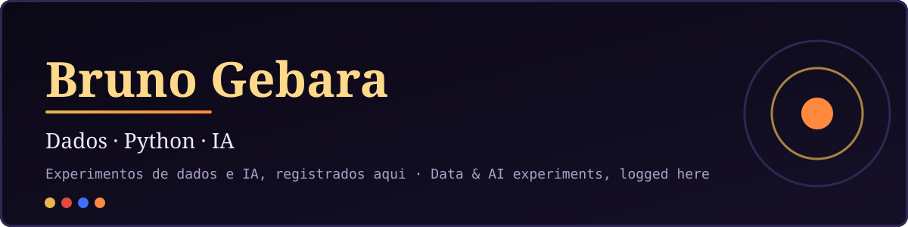

  

# Olá, eu sou o Bruno 👋 · Hi, I'm Bruno 👋

🇧🇷 **Português** · [🇺🇸 English](#-english)

---

## 🇧🇷 Português

Sou **Bruno Gebara** e **lidero um time de dados**. Este GitHub é o meu laboratório: aqui eu faço **experimentos com dados, Python e IA** e registro cada avanço, do rascunho ao resultado.

### 🧭 O que você encontra aqui

- 🧪 Experimentos de **dados** e **análise** em Python
- 🤖 Testes práticos com **inteligência artificial**
- 📊 Painéis e ferramentas que nascem da curiosidade

### 🛠️ Projetos

| | Projeto | O que é |
|---|---|---|
| 📊 | [**Brasil por Governo**](https://github.com/reset-hightide/-brasil-por-governo) · [site](https://reset-hightide.github.io/-brasil-por-governo/) | Painel de dados com 33 indicadores do Brasil, de 1979 a 2025, por governo |
| 🎞️ | [**Course Backup Kit**](https://github.com/reset-hightide/course-backup-kit) | Backup organizado de cursos online que você comprou, com log, relatório e avisos |
| 💎 | [**Hero's Shield HD**](https://github.com/reset-hightide/heros-shield-artwork-hd) · [site](https://reset-hightide.github.io/heros-shield-artwork-hd/) | Mod de arte HD para Zelda 64: Recompiled (Majora's Mask) |

### 🤝 Vamos conversar

---

## 🇺🇸 English

I'm **Bruno Gebara** and I **lead a data team**. This GitHub is my lab: I run **experiments with data, Python and AI** and log every step of progress, from first draft to result.

### 🧭 What you'll find here

- 🧪 **Data** and **analysis** experiments in Python
- 🤖 Hands-on tests with **artificial intelligence**
- 📊 Dashboards and tools that start from curiosity

### 🛠️ Projects

| | Project | What it is |
|---|---|---|
| 📊 | [**Brasil por Governo**](https://github.com/reset-hightide/-brasil-por-governo) · [site](https://reset-hightide.github.io/-brasil-por-governo/) | Data dashboard with 33 indicators of Brazil, 1979 to 2025, by administration |
| 🎞️ | [**Course Backup Kit**](https://github.com/reset-hightide/course-backup-kit) | Organized backup of online courses you bought, with log, report and alerts |
| 💎 | [**Hero's Shield HD**](https://github.com/reset-hightide/heros-shield-artwork-hd) · [site](https://reset-hightide.github.io/heros-shield-artwork-hd/) | HD artwork mod for Zelda 64: Recompiled (Majora's Mask) |

### 🤝 Let's talk

